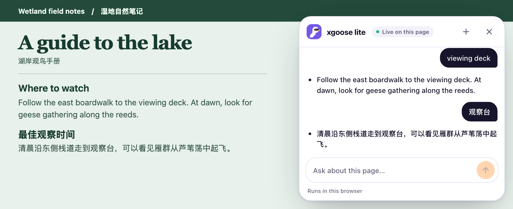

#  xgoose lite

**English** · [简体中文](README.zh-CN.md)

Give visitors a little goose that knows its way around your page. Drop it into a field guide and a reader can find the viewing deck. Give it a model and a booking tool, and a visitor can ask which tours still have seats. You choose what the goose can read and what it can do. Visitors just open your website.

给网站添一只认路的小鹅。访客可以用它查找本页内容；接入模型和你的站点工具后，还能直接在页面上提问、办事。[阅读完整中文指南](README.zh-CN.md)

**[Open the configurator](https://xgoose.org/lite/)** · [Default embed script](https://xgoose.org/lite/xgoose-lite.site.js) · [MIT license](LICENSE)



## Try it with one script

Paste this into an HTML page, open **Ask xgoose**, and search for a word on that page. The default assistant finds matching passages and can show a page outline. Both run in the browser, with no AI account, API key or extension required.

```html
<script defer src="https://xgoose.org/lite/xgoose-lite.site.js"></script>
```

To make it yours, open the configurator. Set the name, appearance, greeting and suggested questions. Choose a provider and the page tools you want to enable. Click **下载配置好的 JS** to download the runtime and settings as one file. Put it at the root of your site and use this tag. The configurator preview always runs locally. Your provider choice takes effect on the embedded site. [Configure your assistant](https://xgoose.org/lite/)

```html
<script defer src="/xgoose-lite.site.js"></script>
```

## Choose who powers the conversation

| Mode | What visitors can do | Who provides the model credit |
| --- | --- | --- |
| `local` · default | Search page text and open its outline, including offline once loaded. | No model calls. |
| `site` | Ask questions using their existing login on your site. | Your backend issues a short-lived chat token and enforces each user's allowance. |
| `hosted` | Sign in to xgoose and approve a question in the official popup. | The visitor's own xgoose Hosted balance. |

In either AI mode, tools can read the page, find text, list controls and scroll to an element. You can also enable clicking and text entry. Use `data-xgoose-ignore` to exclude a subtree. The widget supports English, Chinese and Spanish, and follows the page language by default.

### Use your site's login

1. Lite sends `POST {}` to a same-origin token endpoint with the visitor's session cookie. Return 401 for a signed-out visitor. For a signed-in visitor, return `{"access_token":"…"}` with `Cache-Control: no-store`. Scope the short-lived token to chat for that user.
2. Lite sends `Authorization: Bearer <access_token>` to your Chat Completions endpoint with `messages`, an optional `model`, any enabled `tools`, and `stream: true`. Your endpoint verifies the token, enforces the allowance and calls the model with your server-side provider key. Only the token endpoint receives the site's cookie.
3. The chat endpoint can return OpenAI-compatible SSE or JSON. A chat 401 triggers one fresh token and one retry. A cross-origin chat endpoint must allow the embedding origin, POST, and the Content-Type and Authorization request headers.

An Express integration can use your existing session middleware and billing code. The grant and chat handlers below are supplied by your site.

```js
app.post("/api/xgoose/token", requireWebsiteSession, async (req, res) => {
  const token = await issueChatGrant({ userId: req.user.id, expiresInSeconds: 120 });
  res.set("Cache-Control", "no-store").json({ access_token: token });
});
app.post("/api/xgoose/chat", verifyChatGrant, handleMeteredChat);
```

### Use the visitor's xgoose balance

Select `hosted` in the configurator. When a visitor asks a question, the official xgoose window shows the question, model and full initial request for approval. Each approval covers one question and its tool follow-ups, up to six model calls over ten minutes. Closing the window ends access. Your site receives model replies and tool calls. Account credentials stay with xgoose.

The popup uses the first-party session for `/me`, `/auth/refresh` and `/ai/v1/chat/completions`. Hosted returns a complete JSON answer and uses the official default model unless you select one. Sites that enforce strict Cross-Origin-Opener-Policy isolation should use `site` mode.

## Give the goose a site-specific skill

Build the project and import `dist/xgoose-lite.mjs` directly, or run `npm pack` and install the resulting tarball in your app to use the package import below. The classic script `dist/xgoose-lite.js` exposes the same API on `window.XGooseLite`.

This docs assistant can answer “Which version am I reading?” using the page's own `data-version` attribute.

```js
import { init } from "xgoose-lite";

const assistant = init({
  name: "Docs guide",
  provider: "site",
  tokenUrl: "/api/xgoose/token",
  endpoint: "/api/xgoose/chat",
  instructions: "Link to the relevant docs in your answers.",
  suggestions: ["Which version am I reading?"],
  pageTools: ["read_page", "find_on_page", "list_actions", "scroll_to"],
  skills: [{
    name: "docs",
    tools: [{
      name: "current_version",
      description: "Read the version of the documentation being viewed.",
      run: () => ({ version: document.documentElement.dataset.version }),
    }],
  }],
});

assistant.open();
```

Use `assistant.ask(text)` to ask from your own UI, `assistant.update({ theme: "dark" })` to change the theme, and `assistant.destroy()` to unmount. Chat history lives in the widget's memory. In a single-page app, destroy and reinitialize the widget when the signed-in user changes.

## Build and test

Use Node.js 22 or newer. The project has no runtime npm dependencies.

```sh
npm ci
npm run build
npm start
```

Open the [local configurator](http://127.0.0.1:4173/) or open `dist/index.html` directly for offline configuration. The default self-mounting script is `dist/xgoose-lite.site.js`.

```sh
npx playwright install chromium
npm test
npm pack --dry-run
```

The browser tests use simulated model endpoints. For official releases, xgoose maintainers serve `dist/lite/connect/index.html` and `connect.js` together at `https://xgoose.org/lite/connect/`, retaining frame protection and the popup's opener connection.

The chat loop, panel, page tools and Markdown renderer come from the xgoose website's `web/lite` at `43b7646`. The goose icon comes from the xgoose extension at `d164106`. [MIT license](LICENSE)
