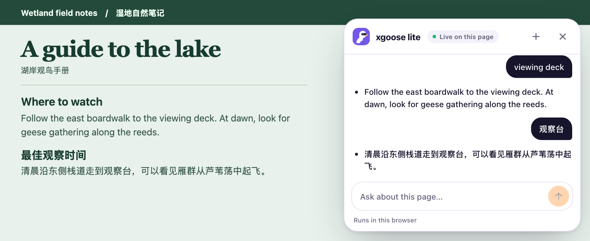

#  xgoose lite

[English](README.md) · **简体中文**

给网站添一只认路的小鹅。把它放进观鸟手册，读者输入「观察台」就能找到带路的那段文字。接入模型，再给它一个查询余位的工具，访客就能直接问「今天哪一场还有名额？」。小鹅能读什么、能做什么，由站长决定。访客打开网页就能用。

**[打开官网配置器](https://xgoose.org/lite/)** · [默认嵌入脚本](https://xgoose.org/lite/xgoose-lite.site.js) · [MIT 许可证](LICENSE)



## 一行脚本，先在自己的页面试试

把下面这行加到 HTML 页面里，打开右下角的「问问 xgoose」，输入页面上的一个词。默认助手会找出匹配的段落，也可以列出页面大纲。这两项都在浏览器本地运行，无需 AI 账号、API 密钥或浏览器扩展。

```html
<script defer src="https://xgoose.org/lite/xgoose-lite.site.js"></script>
```

要做成自己网站的助手，可以在配置器里改名称、外观、欢迎语和建议提问，再选好对话服务与页面工具。点击「下载配置好的 JS」，运行时和设置就会打包进同一个文件。把文件放在网站根目录，按下面的方式引入即可。配置器右侧始终使用本地预览，选择的对话服务会在嵌入网站后生效。[配置你的助手](https://xgoose.org/lite/)

```html
<script defer src="/xgoose-lite.site.js"></script>
```

## 选择对话方式和额度来源

| 模式 | 访客体验 | 模型额度 |
| --- | --- | --- |
| `local` · 默认 | 搜索本页文字、查看大纲。脚本加载后，离线也能用。 | 无模型调用。 |
| `site` | 沿用本站登录身份，直接在网页上提问。 | 网站后端签发短期聊天凭证，并控制每位用户的额度。 |
| `hosted` | 登录 xgoose，在官方弹窗中授权本次提问。 | 使用访客自己的 xgoose Hosted 余额。 |

两种 AI 模式都支持读取页面、查找文字、列出控件和滚动定位。站长还可以单独开启点击与填写文本。给元素加上 `data-xgoose-ignore` 即可排除整个子树。助手界面支持中文、英文和西班牙文，默认跟随网页语言。

### 沿用本站登录

1. Lite 向同源 token 接口发送 `POST {}`，携带本站会话 cookie。访客未登录时返回 401。登录后返回 `{"access_token":"…"}`，并加上 `Cache-Control: no-store`。短期凭证绑定当前用户，仅限聊天用途。
2. Lite 向配置的 Chat Completions 接口发送 `Authorization: Bearer <access_token>`，请求包括 `messages`、可选的 `model`、启用的 `tools` 以及 `stream: true`。后端校验凭证和额度，用保存在服务端的供应商密钥调用模型。本站 cookie 只发给 token 接口。
3. 聊天接口可返回 OpenAI 兼容的 SSE 或 JSON。聊天请求遇到 401 时，Lite 会重新获取凭证并重试一次。跨源聊天接口需要允许嵌入网站的来源、POST 方法以及 Content-Type 和 Authorization 请求头。

下面是 Express 接入示例。会话校验、凭证签发、凭证验证和聊天计费函数由网站提供。

```js
app.post("/api/xgoose/token", requireWebsiteSession, async (req, res) => {
  const token = await issueChatGrant({ userId: req.user.id, expiresInSeconds: 120 });
  res.set("Cache-Control", "no-store").json({ access_token: token });
});
app.post("/api/xgoose/chat", verifyChatGrant, handleMeteredChat);
```

### 使用访客的 xgoose 余额

在配置器中选择 `hosted`。访客提问后，xgoose 官方弹窗会展示问题、模型以及可展开查看的完整首轮请求。每次授权对应一个问题及其后续工具调用，十分钟内最多调用模型六次。关闭弹窗即可结束授权。网站收到模型回复和工具调用，账号凭证保留在 xgoose。

弹窗通过第一方登录会话访问 `/me`、`/auth/refresh` 和 `/ai/v1/chat/completions`。Hosted 返回完整 JSON 回答，未指定模型时使用官网默认模型。启用严格 Cross-Origin-Opener-Policy 隔离的网站可以选用 `site` 模式。

## 教小鹅使用你的网站工具

构建后可以直接导入 `dist/xgoose-lite.mjs`。也可以运行 `npm pack`，把生成的包安装到项目后，按下面的方式导入。经典脚本版 `dist/xgoose-lite.js` 通过 `window.XGooseLite` 提供相同接口。

这个文档助手可以从网页的 `data-version` 属性读取版本，回答读者「我正在看哪个版本的文档？」。

```js
import { init } from "xgoose-lite";

const assistant = init({
  name: "文档助手",
  locale: "zh",
  provider: "site",
  tokenUrl: "/api/xgoose/token",
  endpoint: "/api/xgoose/chat",
  instructions: "回答时附上相关文档链接。",
  suggestions: ["我正在看哪个版本的文档？"],
  pageTools: ["read_page", "find_on_page", "list_actions", "scroll_to"],
  skills: [{
    name: "docs",
    tools: [{
      name: "current_version",
      description: "读取当前页面的文档版本。",
      run: () => ({ version: document.documentElement.dataset.version }),
    }],
  }],
});

assistant.open();
```

可以通过 `assistant.ask(text)` 从自己的界面发起提问，用 `assistant.update({ theme: "dark" })` 切换主题，用 `assistant.destroy()` 卸载助手。对话保存在组件内存中。单页应用切换登录身份时，请销毁并重新初始化助手。

## 本地构建与验证

需要 Node.js 22 或更高版本。项目没有运行时 npm 依赖。

```sh
npm ci
npm run build
npm start
```

打开[本地配置器](http://127.0.0.1:4173/)，或直接双击 `dist/index.html` 离线配置。采用默认设置、加载后自动挂载的脚本是 `dist/xgoose-lite.site.js`。

```sh
npx playwright install chromium
npm test
npm pack --dry-run
```

浏览器测试使用模拟模型接口。官网发布时，xgoose 维护者将 `dist/lite/connect/index.html` 与 `connect.js` 一同部署到 `https://xgoose.org/lite/connect/`，保留防嵌框设置以及授权窗口与嵌入页之间的 opener 连接。

聊天循环、面板、页面工具和 Markdown 渲染源自 xgoose 官网提交 `43b7646` 的 `web/lite`。品牌图标来自 xgoose 扩展提交 `d164106`。[MIT 许可证](LICENSE)
